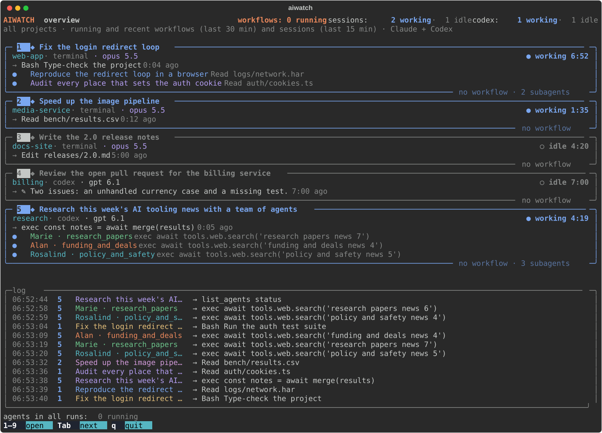
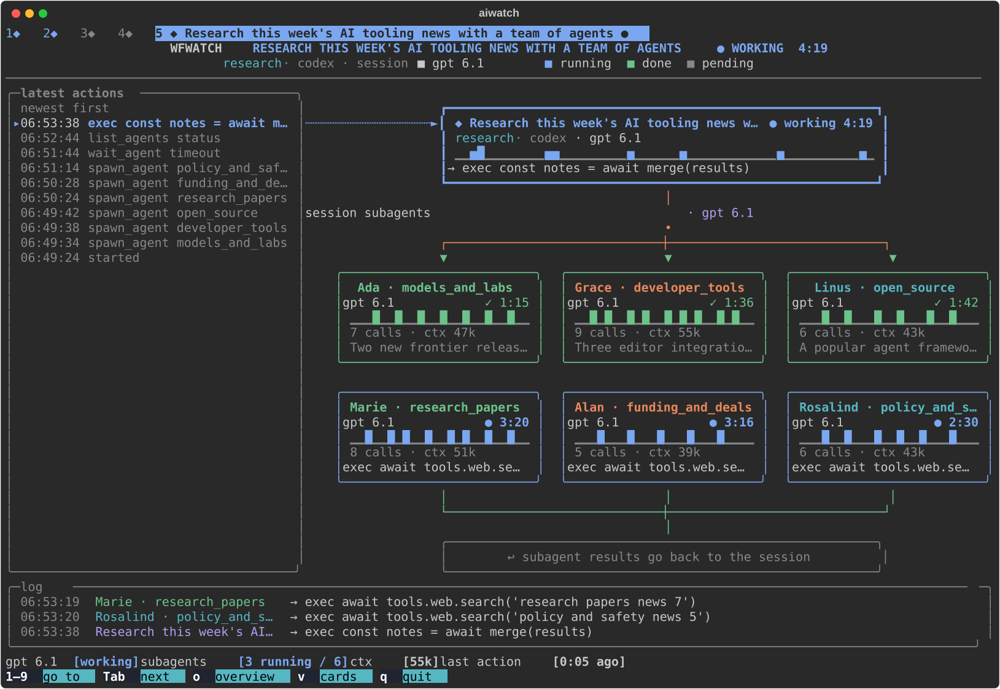
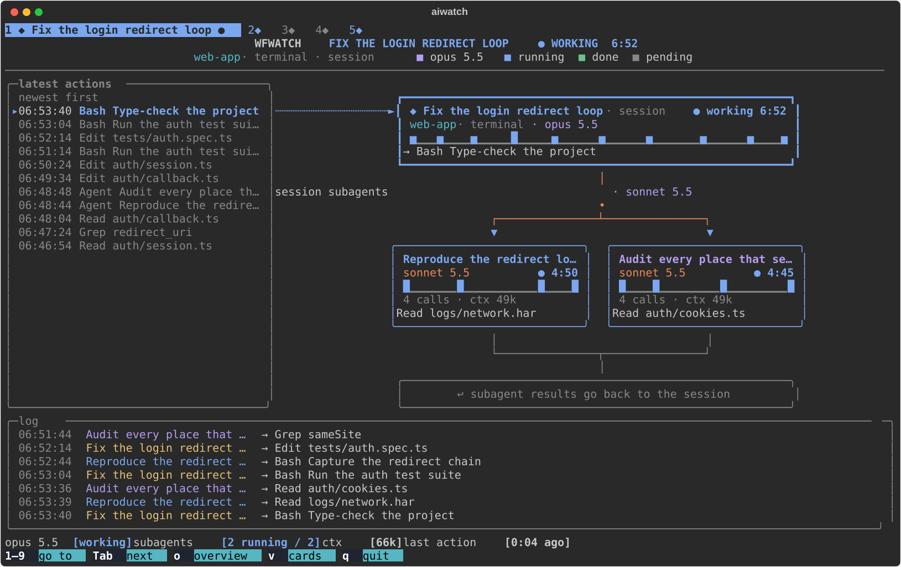

# aiwatch

[wfwatch](https://github.com/zamirka/wfwatch) with **Codex / ChatGPT** sessions added: one live
terminal view of what Claude Code and Codex are doing right now.

It is wfwatch underneath — the same overview, diagrams, cards, log and keys. Each Codex thread is
turned into a wfwatch session, so wfwatch draws it exactly as it draws a Claude session: the state
and timer, the tool-call sparkline, calls / context / output, the latest actions. When Codex runs in
agent mode, the threads it spawns become **subagents of the thread that spawned them** — cards in
its diagram with their own sparkline, status and result — not separate sessions.

**Overview** — Claude Code sessions and Codex threads side by side, with a shared log:



**Codex agent mode** — the agents a thread spawns are drawn as its subagents, each with its own
status, sparkline and result:



**A Claude Code session** — wfwatch's session diagram, with its subagents and latest actions:



*Screenshots show demo sessions.*

## Install

Needs [uv](https://docs.astral.sh/uv/) and Python 3.11+, on macOS, Linux or Windows. On Windows, use
Windows Terminal (or any terminal with Unicode and ANSI color) for the live view.

```bash
uv tool install git+https://github.com/patrickkrebs/aiwatch
```

wfwatch is pulled in as a dependency. From a checkout, `./install.sh` installs it in editable mode.

## Usage

```
aiwatch              live view (q to quit)
aiwatch -c           cards instead of diagrams in the detail views
aiwatch -l           list live sessions and exit
aiwatch --once       print one frame and exit
```

Keys, as in wfwatch: `1`–`9` open an item (two digits for 10+), `Tab` / `→` next, `Shift-Tab` / `←`
previous, `o` / `Esc` / `0` back to the overview, `q` quit. In Claude detail views, `v`, `a`, `↑↓`,
`PgUp`/`PgDn` and `f` work as in wfwatch.

## Data sources

| Source | Read from |
|--------|-----------|
| Claude Code | `~/.claude/sessions/*.json` and `~/.claude/projects/**/*.jsonl` (via wfwatch) |
| Codex thread list | `~/.codex/state_5.sqlite` (read-only) |
| Codex live state and events | `~/.codex/sessions/**/rollout-*.jsonl` (only the tail of each file) |

A Codex thread is *working* between a `task_started` and its `task_complete` / `turn_aborted` in its
rollout log, and stays on screen for 15 minutes after its last activity (or while a subagent runs),
the same rule wfwatch uses for idle Claude sessions. A thread whose `source` names a
`parent_thread_id` is a spawned agent and is folded into that parent; the copy of the parent's
history at the start of its rollout is skipped, so its numbers are its own.

Nothing is written anywhere; both tools only read.

## Credits

aiwatch was created by **Patrick Krebs**. It is built on
[wfwatch](https://github.com/zamirka/wfwatch) by **Zamir Musaev**, which does all the Claude Code
tracking and the drawing; aiwatch adds Codex / ChatGPT to it. Thanks to Zamir for an excellent tool.

## Disclaimer

aiwatch is an independent, unofficial project. It is not affiliated with, endorsed by or supported
by Anthropic, OpenAI, or the author of wfwatch. Claude and Claude Code are trademarks of Anthropic,
PBC; ChatGPT and Codex are trademarks of OpenAI. aiwatch reads files these tools write for their own
use; their format may change with any release.

## License

aiwatch is licensed under the [Apache License 2.0](LICENSE) © 2026 Patrick Krebs.

You are free to use, modify, fork and redistribute it, including commercially, as long as you keep
the [LICENSE](LICENSE) and [NOTICE](NOTICE) files with your copy and credit Patrick Krebs as the
original author, and state the changes you made.

Portions of `src/aiwatch/cli.py` are adapted from wfwatch and remain under its
[MIT License](licenses/wfwatch-LICENSE.txt) © 2026 Zamir Musaev; they are marked in the source.
wfwatch itself is installed as a separate dependency under its own MIT License.
